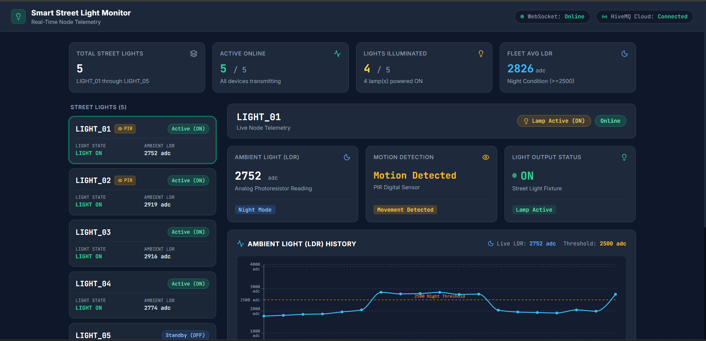
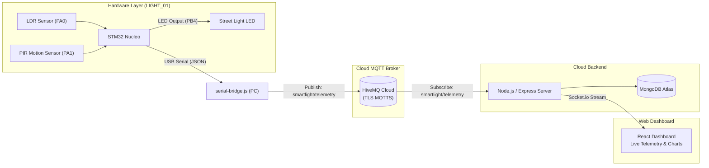

# Smart Street Light Monitoring System

An STM32-based IoT prototype that reads ambient light and motion sensors to control a street light, then streams the sensor readings to a Node.js backend and a React dashboard over MQTT.



## Project Overview

This is a course project on Microcontrollers using stm32 nucleo microcontroller and stm32CubeIDE. The STM32 Nucleo reads an LDR and a PIR sensor, decides whether to turn a connected LED on or off, and sends a small JSON packet over USB serial to a PC. A Node.js script running on that PC picks up the packet and forwards it to a HiveMQ Cloud MQTT broker over TLS. A second Node.js server subscribes to the same broker, persists readings to MongoDB Atlas, and pushes live updates to a React dashboard over Socket.io.

## Features

- **LDR-Based Day/Night Detection:** Reads the LDR voltage divider on a 12-bit ADC. If the raw reading is below 2500 the system treats it as daylight and keeps the LED off; 2500 and above is treated as nighttime.
- **Motion-Triggered Lamp:** In nighttime mode, the LED turns on when the PIR sensor detects motion and turns off when the signal goes low.
- **USB Serial Bridge:** `serial-bridge.js` opens the Nucleo's virtual COM port at 115200 baud, prints each incoming JSON line to the terminal, and publishes it to HiveMQ Cloud over MQTTS (port 8883). If the port disconnects it retries every 3 seconds automatically.
- **MQTT over TLS:** Both the serial bridge and the mock scripts connect to HiveMQ Cloud using `mqtts://` with username/password authentication and `rejectUnauthorized: true`.
- **Node Offline Detection:** The backend keeps a 120-second timer per device ID. If no packet arrives within that window the server emits an `OFFLINE` status update over Socket.io.
- **Throttled DB Writes:** Telemetry is saved to MongoDB Atlas at most once every 30 seconds per device during normal operation.
- **Daytime Anomaly Alerts:** The `/api/alerts` endpoint returns records where the light was on (`light_status: true`) while the LDR reading indicated daytime (`ldr_value < 2500`).
- **React Dashboard:** Shows all five nodes in a sidebar list, displays LDR value, motion state, and light status per node, plots a live LDR history chart (last 30 readings), and logs raw incoming packets in a collapsible terminal drawer at the bottom (see [dashboard preview](assets/dashboard-ui.png)).
- **Mock Scripts for Testing:** Three scripts let you test without physical hardware — a multi-node simulator, a single-node hardware emulator, and a custom one-shot publisher.

## Hardware

Detailed wiring information and visual diagrams are provided in the [`hardware/`](hardware/) directory:
- 📋 **[Pinout Specification & Text Diagram](hardware/pinout.md)**: Full pin tables, ADC/PWM timer configurations, logic levels, and wiring checklist.
- 🖼️ **[Circuit Wiring Diagram](hardware/wiring-diagram.png)**: Visual schematic of the Nucleo board, sensors, LED, and breadboard connections.

### Components

| Component | Details | Purpose |
| :--- | :--- | :--- |
| Microcontroller | STM32 Nucleo-F411RE / F446RE (ARM Cortex-M4) | Reads sensors, drives LED, sends JSON over USB serial |
| Ambient Light Sensor | Photoresistor (LDR) in a voltage divider with a 10 kΩ pull-down resistor | Measures ambient light level on a 12-bit ADC (0–4095) |
| Motion Sensor | HC-SR501 PIR in retrigger mode | Detects motion as a digital GPIO input |
| Light Output | Blue LED with 220 Ω series resistor | Simulates a street light load |
| USB Cable | Micro-USB (Nucleo ST-LINK VCP) | Powers the board and provides the 115200 baud serial connection to PC |

### Pin Connections

> For full connection details, alternate functions, and breadboard hookup notes, refer to the [Pinout Guide](hardware/pinout.md) and [Wiring Diagram](hardware/wiring-diagram.png).

| Signal | STM32 Pin | Notes |
| :--- | :--- | :--- |
| LDR voltage divider output | PA0 (ADC1_IN0) | 12-bit analog input |
| PIR OUT | PA1 (GPIO_IN) | Digital input, 3.3V logic |
| LED (via TIM3_CH1 PWM) | PB4 | Driven at 0%, 20%, or 100% duty cycle |
| Common GND | GND | Board and breadboard ground tied together |

## Software & Tools

- **Firmware:** C/C++ in STM32CubeIDE using HAL drivers
- **Backend:** Node.js (v18+), Express, `mqtt.js`, `socket.io`, `mongoose`, `serialport`
- **MQTT Broker:** HiveMQ Cloud Serverless (MQTTS on port 8883)
- **Database:** MongoDB Atlas (M0 Free Tier)
- **Frontend:** React 18, Vite, Tailwind CSS, Recharts, Lucide React, Socket.io Client

## Setup

### What You Need

- STM32 Nucleo-F411RE or F446RE board, LDR, 10 kΩ resistor, HC-SR501 PIR sensor, a blue LED, 220 Ω resistor, breadboard, and jumper wires
- [Node.js](https://nodejs.org/) v18 or newer
- [STM32CubeIDE](https://www.st.com/en/development-tools/stm32cubeide.html) to compile and flash the firmware
- A free [HiveMQ Cloud](https://www.hivemq.com/cloud/) cluster
- A free [MongoDB Atlas](https://www.mongodb.com/cloud/atlas) cluster

### 1. Clone the Repo

```bash
git clone https://github.com/basilpeter01/stm32-smart-light.git
cd stm32-smart-light
```

### 2. Flash the STM32

1. Wire the circuit according to the [pinout guide](hardware/pinout.md) and [wiring diagram](hardware/wiring-diagram.png).
2. Connect the Nucleo board to your PC via USB.
3. Open the firmware project in STM32CubeIDE and flash it to the board.
4. Note the COM port the Nucleo appears on (e.g. `COM3` on Windows, `/dev/ttyACM0` on Linux).

### 3. Backend

1. Navigate to `backend/` and install dependencies:
   ```bash
   cd backend
   npm install
   ```

2. Copy the example env file and fill in your credentials:
   ```bash
   cp .env.example .env
   ```
   ```env
   PORT=5000
   MQTT_URL=mqtts://<your-cluster>.s1.eu.hivemq.cloud:8883
   MQTT_USER=<your-hivemq-username>
   MQTT_PASSWORD=<your-hivemq-password>
   MONGO_URI=mongodb+srv://<user>:<pass>@cluster0.mongodb.net/smartlight?retryWrites=true&w=majority
   SERIAL_PORT=COM3
   SERIAL_BAUD=115200
   FRONTEND_URL=http://localhost:5173
   ```

3. In MongoDB Atlas, go to **Network Access** and allow your current IP (or `0.0.0.0/0` while developing).

4. Start the ingestion server:
   ```bash
   npm start
   ```

5. In a separate terminal, start the USB serial bridge (reads from the Nucleo and publishes to HiveMQ):
   ```bash
   npm run serial-bridge
   ```

### 4. Frontend

1. Navigate to `frontend/` and install dependencies:
   ```bash
   cd frontend
   npm install
   ```

2. If your backend is not running on `localhost:5000`, create a `.env` file in `frontend/`:
   ```env
   VITE_BACKEND_URL=http://localhost:5000
   ```

3. Start the dev server:
   ```bash
   npm run dev
   ```

4. Open `http://localhost:5173` in your browser to view the [live dashboard](assets/dashboard-ui.png).

### 5. Testing Without Hardware

There are three ways to send test data without the physical board:

**Simulate LIGHT_01 (the physical node) via the serial bridge mock mode:**
```bash
npm run serial-bridge:mock
```
This generates packets for `LIGHT_01` in a day/night cycle every 4 seconds and publishes them through the same serial bridge pipeline.

**Simulate LIGHT_02 through LIGHT_05 (four virtual nodes):**
```bash
npm run mock
```
Each virtual node publishes independently on a random 4–7 second interval. Day/night is determined by your current system clock hour (night = 18:00–06:00).

**Send a single custom payload:**
Edit `backend/mock/custom-payload.json`, then run:
```bash
npm run publish-custom
```

## How It Works



### Telemetry Packet

The STM32 sends a line like this over serial. The serial bridge normalises field names and forwards it as-is:

```json
{
  "device_id": "LIGHT_01",
  "light_status": true,
  "ldr_value": 2840,
  "motion_detected": true
}
```

The backend adds `timestamp` and `status` before emitting to the dashboard:

```json
{
  "device_id": "LIGHT_01",
  "node_id": "LIGHT_01",
  "light_status": true,
  "ldr_value": 2840,
  "motion_detected": true,
  "timestamp": 1726748231000,
  "status": "ONLINE"
}
```

### Decision Logic on the STM32

1. Read the LDR ADC value continuously.
2. If `ldr_value < 2500` → daytime → LED off regardless of motion.
3. If `ldr_value >= 2500` → nighttime → LED on if PIR detects motion, off otherwise.
4. Serialize the current state to JSON and send over USART at 115200 baud.

### REST API

| Endpoint | What it returns |
| :--- | :--- |
| `GET /api/nodes` | Latest known state of all registered nodes (from in-memory map) |
| `GET /api/nodes/:id/history` | Last 50 `{timestamp, ldr_value, light_status}` records from MongoDB for a node |
| `GET /api/alerts` | Records where `light_status` was `true` and `ldr_value < 2500` (light on during daytime) |

## Known Limitations & Future Improvements

- **Single LDR threshold with no hysteresis:** The code switches the LED at a single ADC value (2500). Right around dusk and dawn, when ambient light is near that value, the LDR reading fluctuates and the LED can toggle rapidly. Adding hysteresis (separate on/off thresholds) or averaging a few readings before switching would fix this.
- **In-memory node state is lost on restart:** The server tracks the most recent state for each device in a JavaScript `Map`. If the server process restarts, all nodes appear `OFFLINE` until the next packet arrives. Loading the most recent MongoDB document per node at startup would solve this.
- **No downlink commands:** Telemetry only flows from the hardware to the cloud. There is no way from the dashboard to change the LDR threshold or force a light on/off. Adding a second MQTT topic for commands and reading it on the STM32 would make the system interactive.

## License

This project is licensed under the [MIT License](LICENSE).
