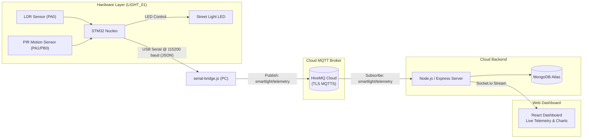

# Smart Street Light Monitoring System

A university microcontroller course project that uses an STM32 Nucleo board to read light and motion sensors, control an LED street light, and stream telemetry data to a Node.js backend and a React dashboard over MQTT.


## Project Overview

This project was built for a microcontrollers course to connect embedded hardware with a monitoring web interface. An STM32 Nucleo board reads analog photoresistor (LDR) and digital PIR motion sensor. When ambient light drops below a threshold and motion is detected, the microcontroller turns on the LED representing a street light. 

Every 3 seconds, the microcontroller prints a JSON telemetry packet over USB serial to a connected PC. A Node.js serial bridge script forwards these packets over TLS to a HiveMQ Cloud MQTT broker. An Express backend subscribes to the broker, records data in MongoDB Atlas, and streams live updates to the web dashboard using Socket.io.

## Repository Structure

```text
smart-street-light/
├── assets/                  # Dashboard screenshots and architecture documentation
├── backend/                 # Node.js server, serial bridge, and mock test scripts
│   ├── mock/                # Simulation scripts for multi-node testing
│   ├── serial-bridge.js     # Reads USB serial from STM32 and publishes to MQTT
│   ├── server.js            # Express API, MongoDB storage, and Socket.io server
│   └── .env.example         # Template for environment variables
├── docs/                    # Deprecated reference notes
├── firmware/                # STM32CubeIDE project files and bare-metal C code
│   └── Street Light/
│       ├── Core/            # Application code (main.c, adc.c, gpio.c, etc.)
│       ├── Drivers/         # STM32 HAL and CMSIS driver files
│       └── Street Light.ioc # CubeMX pin and peripheral configuration
├── frontend/                # React dashboard built with Vite and Tailwind CSS
│   └── src/                 # UI components, Socket.io client, and API services
├── hardware/                # Hardware pin mapping and circuit diagram
│   ├── pinout.md            # Detailed pin reference and text diagram
│   └── wiring-diagram.png   # Breadboard and component wiring schematic
└── README.md
```

## Features

- **Automatic Night Lighting:** Reads an analog LDR using a 12-bit ADC. If ambient light is low and the PIR sensor detects motion, the street light turns on.
- **Timed Shutoff:** When motion triggers the lamp at night, an internal timer keeps the light on for 5 seconds before switching off if no new motion is detected.
- **Serial Output:** The microcontroller formats telemetry as standard JSON strings and sends them over the ST-LINK USB Virtual COM port at 115200 baud.
- **Serial-to-MQTT Bridge:** `serial-bridge.js` connects to the local serial port, parses JSON lines, and securely publishes them to HiveMQ Cloud over TLS (`mqtts://` on port 8883).
- **Cloud Backend & Throttled Database Storage:** `server.js` subscribes to the MQTT telemetry topic and saves readings to MongoDB Atlas. Writes are throttled to once every 30 seconds per light pole to avoid unnecessary database overhead on free tiers.
- **Node Disconnection Tracking:** If no telemetry arrives from a device for 120 seconds, the backend automatically flags it as offline and notifies the frontend.
- **Daytime Anomaly Alerts:** An API endpoint flags instances where a light was turned on during daylight conditions (useful for identifying faulty switches or broken sensors).
- **Live React Dashboard:** Displays active nodes, live LDR readings, motion status, a rolling 30-point history chart, and a slide-out log drawer showing raw incoming packets.
- **Hardware-Free Testing:** Includes mock generator scripts to simulate multiple street light poles (`LIGHT_01` through `LIGHT_05`) without needing multiple physical microcontrollers.

## Hardware Setup

Detailed pin descriptions, voltage levels, and breadboard hookups are documented in the [`hardware/`](hardware/) directory:
- [Hardware Pinout Specification](hardware/pinout.md)
- [Wiring Diagram](hardware/wiring-diagram.png)

### Parts Used

| Component | Specification | Purpose |
| :--- | :--- | :--- |
| Microcontroller | STM32 Nucleo-F446RE (or F411RE) | Runs control logic, reads sensors, prints serial JSON |
| Ambient Light Sensor | Photoresistor (LDR) module | Outputs analog voltage proportional to daylight |
| Motion Sensor | HC-SR501 PIR sensor (set to retrigger mode) | Outputs 3.3V digital high when movement is detected |
| Street Light Indicator | Blue / Green LED with 220 Ω resistor | Represents the physical street light lamp |
| USB Connection | Micro-USB cable | Powers the Nucleo board and provides serial link to PC |

### Pin Mapping

| Peripheral | Board Pin | Type | Function |
| :--- | :--- | :--- | :--- |
| LDR Module (AO) | `PA0` | Analog Input (`ADC1_IN0`) | Reads ambient light level (12-bit, 0–4095) |
| PIR Sensor (OUT) | `PA1` / `PB0` | Digital Input (`GPIO_IN`) | Reads motion trigger |
| LED Indicator | `PB4` / `PA5` | Digital / PWM Output | Lamp output |
| USB Serial | `PA2` (TX) / `PA3` (RX) | `USART2` | 115200 baud serial connection to PC via ST-LINK |
| Power Rails | `+5V`, `GND` | Power | Supplies 5V to sensor modules and common ground |

## Software & Tools

- **Firmware:** Bare-metal C in STM32CubeIDE using ST Hardware Abstraction Layer (HAL) libraries
- **Backend:** Node.js (v18+), Express, `serialport`, `mqtt`, `socket.io`, `mongoose`
- **MQTT Broker:** HiveMQ Cloud Serverless (MQTTS, TLS port 8883)
- **Database:** MongoDB Atlas
- **Frontend:** React 18, Vite, Tailwind CSS, Recharts, Socket.io client

## Getting Started

### Prerequisites

- [STM32CubeIDE](https://www.st.com/en/development-tools/stm32cubeide.html) (Version 1.8.0 or newer)
- [Node.js](https://nodejs.org/) (Version 18 or newer)
- A free [HiveMQ Cloud](https://www.hivemq.com/cloud/) account
- A free [MongoDB Atlas](https://www.mongodb.com/cloud/atlas) account

### 1. Clone the Repository

```bash
git clone https://github.com/basilpeter01/stm32-smart-light.git
cd stm32-smart-light
```

### 2. Flash the Firmware

1. Wire your sensors and LED according to [hardware/pinout.md](hardware/pinout.md).
2. Connect the STM32 Nucleo board to your computer using a micro-USB cable.
3. Open STM32CubeIDE and choose **File > Open Projects from File System...**, then browse to the `firmware/Street Light` folder.
4. Build the project and click **Run** (or flash using the ST-LINK debugger).
5. Open Device Manager on Windows (or run `ls /dev/ttyACM*` on Linux) to find your ST-LINK Virtual COM port (e.g. `COM3`).

### 3. Backend Setup

1. Open a terminal in the `backend/` folder and install dependencies:
   ```bash
   cd backend
   npm install
   ```

2. Create your `.env` configuration file:
   ```bash
   cp .env.example .env
   ```

3. Fill in your credentials in `.env`:
   ```env
   PORT=5000
   MQTT_URL=mqtts://<your-cluster-id>.s1.eu.hivemq.cloud:8883
   MQTT_USER=<your-hivemq-username>
   MQTT_PASSWORD=<your-hivemq-password>
   MONGO_URI=mongodb+srv://<user>:<password>@cluster0.mongodb.net/smartlight?retryWrites=true&w=majority
   SERIAL_PORT=COM3
   SERIAL_BAUD=115200
   FRONTEND_URL=http://localhost:5173
   ```

4. Start the backend server:
   ```bash
   npm start
   ```

5. In a second terminal, start the serial bridge to read from the STM32 and forward packets to HiveMQ:
   ```bash
   npm run serial-bridge
   ```

### 4. Frontend Setup

1. In a new terminal, navigate to `frontend/` and install dependencies:
   ```bash
   cd frontend
   npm install
   ```

2. Start the Vite development server:
   ```bash
   npm run dev
   ```

3. Open `http://localhost:5173` in your browser to view the dashboard.

### 5. Testing Without Physical Hardware

If you don't have the Nucleo board plugged in, you can test the backend and dashboard using the built-in mock scripts:

- **Simulate the physical node (`LIGHT_01`):**
  ```bash
  cd backend
  npm run serial-bridge:mock
  ```
- **Simulate four virtual light poles (`LIGHT_02` to `LIGHT_05`):**
  ```bash
  cd backend
  npm run mock
  ```
- **Publish a single custom test reading:**
  ```bash
  cd backend
  npm run publish-custom
  ```

## How It Works



### Telemetry Packet

The STM32 sends a line like this over serial. The serial bridge normalises field names and forwards it as-is:

```json
{
  "device_id": "LIGHT_01",
  "light_status": true,
  "ldr_value": 2840,
  "motion_detected": true
}
```

The backend adds `timestamp` and `status` before emitting to the dashboard:

```json
{
  "device_id": "LIGHT_01",
  "node_id": "LIGHT_01",
  "light_status": true,
  "ldr_value": 2840,
  "motion_detected": true,
  "timestamp": 1726748231000,
  "status": "ONLINE"
}
```

### Decision Logic on the STM32

1. Read the LDR ADC value continuously.
2. If `ldr_value < 2500` → daytime → LED off regardless of motion.
3. If `ldr_value >= 2500` → nighttime → LED on if PIR detects motion, off otherwise.
4. Serialize the current state to JSON and send over USART at 115200 baud.

### REST API

| Endpoint | What it returns |
| :--- | :--- |
| `GET /api/nodes` | Latest known state of all registered nodes (from in-memory map) |
| `GET /api/nodes/:id/history` | Last 50 `{timestamp, ldr_value, light_status}` records from MongoDB for a node |
| `GET /api/alerts` | Records where `light_status` was `true` and `ldr_value < 2500` (light on during daytime) |

## Known Limitations & Future Improvements

- **Single LDR threshold with no hysteresis:** The code switches the LED at a single ADC value (2500). Right around dusk and dawn, when ambient light is near that value, the LDR reading fluctuates and the LED can toggle rapidly. Adding hysteresis (separate on/off thresholds) or averaging a few readings before switching would fix this.
- **In-memory node state is lost on restart:** The server tracks the most recent state for each device in a JavaScript `Map`. If the server process restarts, all nodes appear `OFFLINE` until the next packet arrives. Loading the most recent MongoDB document per node at startup would solve this.
- **No downlink commands:** Telemetry only flows from the hardware to the cloud. There is no way from the dashboard to change the LDR threshold or force a light on/off. Adding a second MQTT topic for commands and reading it on the STM32 would make the system interactive.

## License

This project is licensed under the [MIT License](LICENSE).
